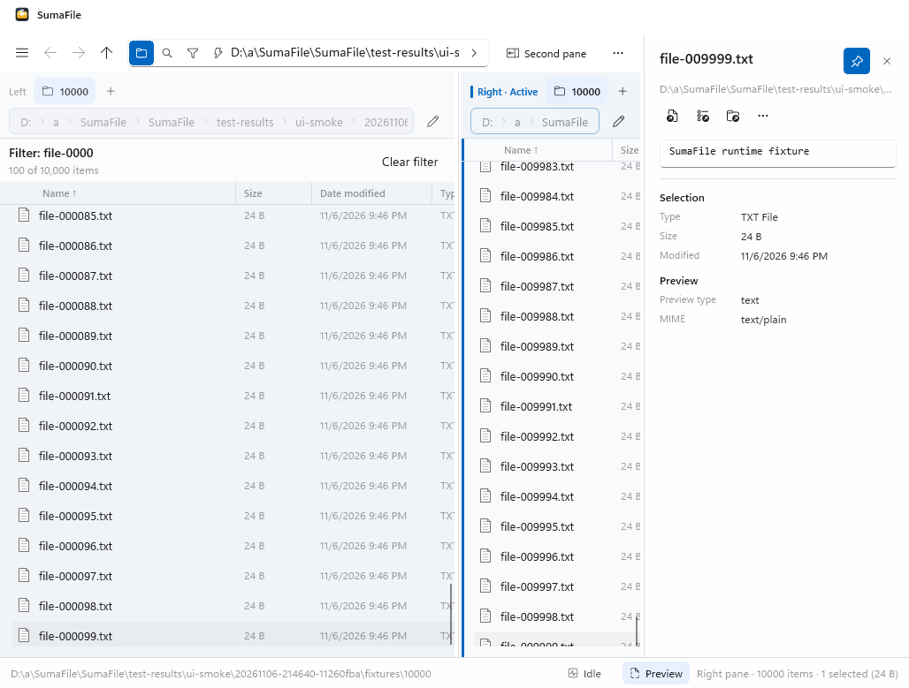
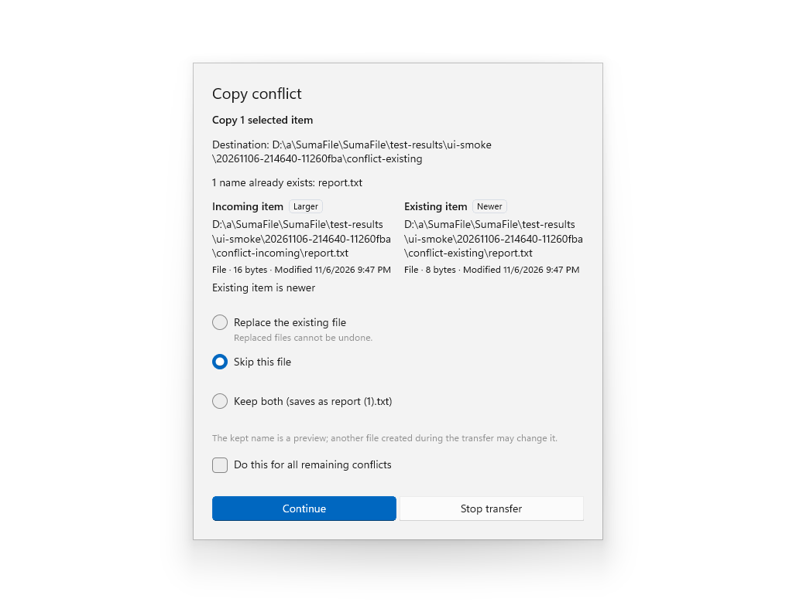
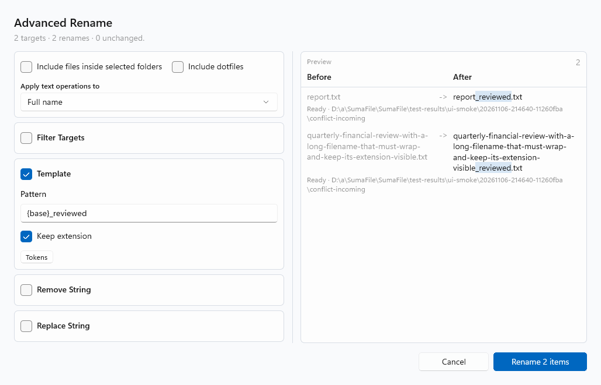

# SumaFile

[](https://github.com/conniecombs/SumaFile/actions/workflows/ci.yml)
[](https://github.com/conniecombs/SumaFile/actions/workflows/release.yml)
[](https://github.com/conniecombs/SumaFile/actions/workflows/installer-smoke.yml)


[](LICENSE)

SumaFile is a native Windows file manager for people who work across several
folders at once and need more than a basic file list. It pairs a WinUI 3 desktop
shell with a Rust filesystem service so browsing, transfers, search, previews,
archives, checksums, cleanup tools and, through bundled plugins, Git status and
remote FTP/SFTP profiles can stay responsive in one local-first app.

## Contents

- [Screenshots](#screenshots)
- [Status](#status)
- [Install](#install)
- [Quick Start](#quick-start)
- [Features](#features)
- [Keyboard Shortcuts](#keyboard-shortcuts)
- [Settings and Data Locations](#settings-and-data-locations)
- [Plugins](#plugins)
- [Known Limitations](#known-limitations)
- [Development](#development)
- [Documentation Map](#documentation-map)
- [Security](#security)
- [Support](#support)
- [License](#license)

## Screenshots

**Dual-pane workspace.** The left pane filters 10,000 sample files down to 100
and shows the filter banner with its Clear filter action. The right pane is
marked active, keeps its own selection, and the pinned preview shows the
selected text file while both panes stay open.



**Copy conflict.** The dialog compares the incoming and existing files, marks
which one is larger and which is newer, and offers Replace, Skip and Keep both
as one choice. Skip is selected by default, **Continue** confirms, and the
Keep both option previews `report (1).txt`.



**Advanced Rename.** The `{base}_reviewed` template adds a suffix while preserving
the extension. The Before and After columns show both proposed names before you
apply them, and the Tokens button explains each placeholder.



These captures come from the v1.0.4 app running on a GitHub-hosted Windows
runner. All visible files and paths belong to its generated test workspace.
[Runtime verification](docs/WINUI_RUNTIME_VERIFICATION.md) says how to refresh
them.

## Status

| Area | Current state |
| --- | --- |
| Product version | `1.1.5` |
| Platform | Windows 10 2004+ / Windows 11, x64 |
| UI | Unpackaged WinUI 3 desktop app |
| Backend | Rust `simplefile-service` over named-pipe JSON-RPC |
| Plugins | Git, FTP/SFTP and 7-Zip ship as bundled plugins; third-party plugins install from a file |
| Release artifacts | NSIS setup, MSI, portable ZIP, updater manifest |
| Storage scope | Local folders, local drives, removable media, mapped network shares, archives, and FTP/FTPS/SFTP connections through the bundled plugin |
| License | [MIT](LICENSE) |

What changed in this version is in its [release notes](docs/RELEASE_1.1.5.md).
Every earlier version is in the [changelog](docs/CHANGELOG.md), and open work
is in the [roadmap](docs/ROADMAP.md).

## Install

Download the latest Windows release from
[GitHub Releases](https://github.com/conniecombs/SumaFile/releases).

| Artifact | Recommended use |
| --- | --- |
| `SumaFile_1.1.5_x64-winui-setup.exe` | Normal per-user installation |
| `SumaFile_1.1.5_x64-winui.msi` | MSI deployment or installer validation |
| `SumaFile_1.1.5_x64-winui-portable.zip` | Portable, extracted-folder usage |
| `latest-winui.json` | Signed updater metadata for published releases |

Requirements:

- Windows 10 version 2004 or newer, or Windows 11
- x64 Windows
- Git for Windows with `git.exe` on `PATH`, for Git status and the Git workbench

`.7z` support (with the bundled 7-Zip), FTP/FTPS/SFTP connections and Git
install with SumaFile as three bundled plugins: `com.sumafile.sevenzip`,
`com.sumafile.remote` and `com.sumafile.git`.

After installing, open Settings -> Updates to check published releases. Builds
with trusted updater metadata can download and launch the NSIS setup from inside
the app. Builds without complete trusted metadata fall back to the release page.
The in-app update always runs the NSIS setup, whatever the running copy was
installed from: update an MSI install with the new MSI and a portable copy
with the new ZIP. [docs/UPDATER_RELEASE.md](docs/UPDATER_RELEASE.md) has the
details.

Uninstalling (Windows Settings -> Apps, or removing the MSI) deletes the
installation folder. That includes every plugin file SumaFile keeps there:
plugins you installed, `plugins-data` (with the FTP/SFTP connection profiles),
`plugin-approvals.json` and `plugins.log`; an upgrade or reinstall keeps them.
Saved FTP/SFTP passwords and passphrases stay in Windows Credential Manager
under `SumaFile.Remote.*` targets: delete the connections in SumaFile before
uninstalling, or remove those entries in Credential Manager. Settings in
`%APPDATA%\com.simplefile.desktop` are not removed.

## Quick Start

1. Open SumaFile.
2. Choose a location from Quick Access, drives, bookmarks, recents, smart
   folders, the optional folder tree, or type a path in the omnibar.
3. Press `F6` to open or close the second pane.
4. Press `Ctrl+T` or `Ctrl+N` to open a tab in the active pane.
5. Leave Preview open for continuous inspection, or press `Space` for Quick
   Look on the selected item.
6. Use right-click menus, toolbar buttons, or `Ctrl+Shift+P` for command
   palette access. Right-click blank pane space for New (folder, text
   document, blank file, shortcut), Paste, Refresh, and the current
   folder's Properties. Right-click an item for Create
   shortcut, which pre-fills the shortcut target. Unavailable commands stay
   visible but greyed out.
7. Run FTP/SFTP manager from the command palette or the toolbar overflow when
   you need a saved FTP, FTPS, or SFTP connection. The bundled FTP/SFTP plugin
   provides it, and lists saved connections under Connections, below the
   built-in sidebar sections.
8. Save repeatable pane/tab/column setups from the Profiles button on the
   toolbar.

## Features

### Navigation and Layout

- Dual-pane browsing with independent pane history, tabs, sort, view and
  selection
- Pane-local tabs with history, close, switch, direct tab shortcuts, and
  Reopen closed tab from the command palette
- Open in other pane on a folder's menu
- Breadcrumbs and a single omnibar for paths, commands, search, and filtering
- Quick Access, drives with labels and network-share status, bookmarks, recent
  locations, smart folders, and folder tree sections
- Persistent pane-local filter counts, Clear filter, and search result banners
  with Return to folder
- Marquee selection, multi-selection, type-ahead selection, and live directory
  refresh
- Recycle Bin as a browsable location with restore, permanent delete, and empty
  actions
- Status bar with the item count and the selection's count and size, shown
  beside the folder address
- Named workspace profiles from the Profiles button: five built in (Standard,
  Developer, Photos, Transfer, Minimal) and your own, each a snapshot of panes,
  tabs, views, columns, sorting and chrome

### Views, Columns and Thumbnails

- Details, list, tiles, and content views, with a per-pane view style, icon
  size, sort column, and sort direction
- A view can be remembered everywhere, for one folder, or for a folder and its
  subfolders ("Remember this view for" in the view menu), and applied to both
  panes at once
- Details columns: Name, Size, Items, Modified, Created, Accessed, Attributes,
  Type, Ext, Status, Link target, Path, Parent, Dimensions, Duration, Date
  taken, Camera, and Pages. Attributes shows Explorer's letters
- A column picker on every column header's right-click and under Columns in the
  list background's menu: a toggle per column and the presets as starting
  points. Each pane keeps its own columns, saved with the layout
- Explorer-style column resizing, size-to-fit, and horizontal scrolling;
  Details stays usable in narrow panes with compact leading columns
- Columns read on demand, one row at a time: Dimensions for images, Duration
  for audio and video, Date taken and Camera for photos, Pages for PDFs, and
  Size and Items for folders. A cell shows "…" while its row can have a value
  that has not been read; click it to read that one value
- Each on-demand column either reads as rows come into view or waits to be
  asked ("Read as rows appear" in its header menu); folder size waits by
  default, and the "folder sizes" setting makes it read as rows appear.
  "Calculate … for this folder" reads a column for the whole folder, with
  progress in the status line and "Stop calculating"
- Values read from files are kept between sessions by each file's size and
  modified time, so a second visit is immediate
- Thumbnails as file icons: SumaFile makes them for JPEG, PNG, GIF, WebP
  and BMP, turned upright by the photo's orientation tag and taken from the
  camera's embedded preview when that is large enough; videos show a frame;
  PDFs and Office documents use Windows' own thumbnails. Settings -> Storage &
  cache controls the thumbnail cache
- Keep-folders-on-top sorting, and settings-controlled visibility of hidden
  and system files

### File Operations and Transfers

- Create file and folder
- Rename and Advanced Rename
- Copy, cut, paste, drag, drop, copy to other pane, and move to other pane
- A Transfers window with a row per task: bytes, totals, rate, ETA, Cancel,
  and per-task Options. A row names a file being copied and counts the others
  running beside it; its Details section lists them all under their source
  folders, with long paths and names shortened to fit
- Copying or moving a folder into a same-name folder merges their contents automatically,
  including nested folders. A file at the same relative path prompts for Replace, Skip,
  or Keep both. Each answer applies to that conflict unless you select **Do this for all remaining conflicts**.
- Undo for a folder merge removes the additions made by that transfer and preserves existing
  destination folders and files. Undoing a merged move returns its files to their source paths.
- Overwrite comparisons show incoming/existing paths, sizes, modification
  dates, and a preview of the Keep both filename
- By default a file is written to a hidden temporary file beside its
  destination and renamed into place when complete, so a half-written file
  never appears under its final name. A move deletes each source only after
  its copy is in place
- Four transfer modes (Automatic, Conservative, Maximum throughput, Custom),
  a bandwidth limit, checksum verification, and automatic retries of files that
  fail, under Transfers -> Transfer defaults and Settings -> Behavior
- Recycle Bin delete and permanent delete
- Undo/redo for create, rename, copy, move, and Recycle Bin delete flows
- Clipboard history for recent copy/cut sets
- Operation journal written to `%LOCALAPPDATA%\SumaFile\operations.jsonl`

[Transfers](docs/TRANSFER_TUNING.md) is the reference for the transfer engine:
every setting, how the automatic modes decide, what a failed or cancelled
transfer leaves behind, and how recovery works. FTP, FTPS and SFTP transfers
run in the FTP/SFTP plugin with the plugin's own settings.

### Preview and Inspection

| Kind | Support |
| --- | --- |
| Images | PNG, JPG/JPEG, GIF, SVG, WebP, BMP, ICO, TIFF |
| PDF | Path-backed PDF preview and metadata |
| Video | MP4, WebM, AVI, MOV, MKV, FLV, WMV, MPEG, OGV |
| Audio | MP3, WAV, FLAC, OGG, AAC, WMA, M4A, AIFF |
| Text and code | Plain text, source files, scripts, config, logs |
| Markdown | Raw text or rendered Markdown with GitHub-flavored tables and task lists |
| Data text | Rendered HTML, JSON/JSONL, CSV/TSV, XML/XAML, YAML, TOML, AsciiDoc, and reStructuredText views |
| Fonts | TTF, OTF, WOFF, WOFF2 |
| Other files | Shell icon and basic metadata fallback |

Inspection tools include:

- Preview pane with Open, Open With, Reveal in folder, Compare, and Checksum
  actions
- Pin preview open, or let unpinned preview collapse when empty or panes are
  cramped; automatic collapsing can be disabled in Settings -> Behavior
- Quick Look for focused inspection
- Properties dialog grouped into General, Attributes, and the file's metadata,
  with values you can select and copy
- A folder's Properties counts its files, folders and total size through every
  subfolder as soon as it opens; one button stops the count and starts it again
- Compare folder metrics for two or more selected folders, shown as a table
- Image dimensions and EXIF where available
- Office/PDF/media metadata where available
- MD5, SHA-1, and SHA-256 checksums
- Text diff for two small UTF-8 files
- Binary comparison with hex/ASCII rows for images, executables, oversized text,
  invalid UTF-8, or other binary content
- A persisted Rendered toggle for Markdown and data files

### Search and Smart Folders

- Filter the active pane as you type in the omnibar’s Filter mode
- Recursive filename search
- Optional content search in the omnibar’s Search mode
- Filters for size, date, depth, and hidden-file inclusion
- Batched, cancellable search results for large trees
- Folders that Windows has indexed can be answered from the Windows Search
  index instead of a walk of the folder
- Smart folders saved from reusable search criteria

### Archives

| Format | Extension(s) | Support |
| --- | --- | --- |
| ZIP | `.zip` | Built in |
| TAR | `.tar` | Built in |
| TAR.GZ | `.tar.gz`, `.tgz` | Built in |
| RAR | `.rar` | Built-in list/extract only |
| 7-Zip | `.7z` | SumaFile 7-Zip plugin (`com.sumafile.sevenzip`), installed with SumaFile |

Archive commands can list contents, view archives, extract here, extract to a
folder, extract to a chosen destination, create archives, pack selections into a
folder, and unpack folders in place. RAR archives can be browsed and extracted,
but SumaFile does not create or rewrite RAR archives.

Extraction validates final output paths before writing. TAR extraction skips
links and special entries that could escape the destination.

### Organization

- Labels for files and folders, shown under Labels in the sidebar
- Bookmarks and recent locations
- Smart folders
- Duplicate checker, and "Large files and duplicates" for finding what takes
  the space in a folder
- Advanced Rename with live preview and collision checks
- Rename preview shows full Before/After names, highlights changes, and labels
  each target Ready, Unchanged, or Conflict

### Git and Developer Tools

- Git comes from the bundled Git plugin (`com.sumafile.git`), which needs Git
  for Windows with `git.exe` on `PATH`
- Developer column preset with a Status column of Git status labels
- Dockable Git workbench with branch/upstream summary, changed paths, resizable
  diff preview, stage, unstage, discard, fetch, pull, push, and commit actions;
  fetch, pull and push run as Transfers rows with Cancel
- Settings -> Plugins -> Git can completely disable Git integration, hiding Git
  UI and preventing Git status/command calls; the Git commands stay listed and
  explain that Git is turned off
- Git hooks and filters still run for your own stage, commit, fetch, pull and
  push, as they do with the git command line; the read-only views (the Status
  column, the workbench's status and the diff preview) run none
- Open terminal here with ``Ctrl+` ``
- Elevated PowerShell launch
- Open With menu and chooser
- Pinned and recent Open With apps per extension
- Command palette with searchable app commands

### FTP/SFTP Manager

FTP, FTPS and SFTP come from the bundled plugin `com.sumafile.remote` ("FTP/SFTP
connections"), which installs and is trusted with SumaFile. It contributes the
FTP/SFTP manager window and command, the Connections sidebar section (below the
built-in sections) and its own page under Settings -> Plugins. Without the
plugin, SumaFile shows no FTP/SFTP UI.

- Saved FTP, FTPS, and SFTP profiles
- Password, anonymous, SSH agent, and private-key authentication modes
- Optional Windows Credential Manager storage for passwords and passphrases
- Profile test before save
- Remote folder browsing with create folder, upload, download, rename, delete,
  refresh, and disconnect actions
- Recursive folder uploads and downloads, including empty folders
- Streamed transfers with byte progress, per-item outcomes, and retry of
  incomplete selections; existing files are preserved until transfer
  completion using temporary files and replacement backups. Each transfer is
  also a row in the Transfers window, with Cancel
- File conflict choices: report, skip, replace, or keep both. Existing folders
  merge; the selected policy applies to files inside them. When retrying a
  partially completed folder, choose skip to keep files already transferred
- Retry remains available after reconnecting to the same profile; transfers
  restart incomplete files from the beginning
- Symbolic links are reported as unsupported during folder transfers
- Plain FTP requires an explicit insecure-connection acknowledgement and is
  marked Insecure in the manager and under Connections in the sidebar
- Remote transfer settings (bandwidth limit, up-to-date check, direct writes,
  pre-allocation, flushing and retries) are the plugin's settings, under
  Settings -> Plugins -> FTP/SFTP connections and in the manager's Transfer
  options dialog

The plugin's backend keeps profiles in
`<install folder>\plugins-data\com.sumafile.remote\remote-profiles.db`: every
plugin file, its data included, stays in SumaFile's installation folder.
On first use after an upgrade from 1.0.4 it imports, read-only, the profiles the
1.0.4 service saved in its `metadata.db`; saved passwords and passphrases stay
in Windows Credential Manager under their `SumaFile.Remote.` targets and keep
working without being entered again. Remote sessions end with the plugin's
backend, not with the file service.

A new SFTP server's key is shown for approval ("Trust this server?"), and a
changed key is refused until you replace the trusted one.

## Keyboard Shortcuts

Press `F1` or `Ctrl+/` in SumaFile for the live shortcut list.

| Shortcut | Action |
| --- | --- |
| `Ctrl+L` / `Alt+D` | Focus path bar |
| `Enter` | Open selected item |
| `Ctrl+Enter` | Open folder in new tab |
| `Alt+Enter` | Properties |
| `Alt+Home` | Go home |
| `Alt+Up` | Parent folder |
| `Alt+Left` / `Alt+Right` | Back / forward |
| `Backspace` | Back (when a file list has focus) |
| `F5` | Refresh |
| `F6` | Open or close second pane |
| `Tab` | Switch active pane when a file list has focus and dual pane is open |
| `Alt+1` / `Alt+2` | Focus left / right pane |
| `Ctrl+Shift+Left` / `Ctrl+Shift+Right` | Focus left / right pane |
| `Ctrl+T` or `Ctrl+N` / `Ctrl+W` | New tab / close tab |
| `Ctrl+Tab` / `Ctrl+Shift+Tab` | Next / previous tab |
| `Ctrl+1`-`Ctrl+9` | Jump to tab; `9` means last tab |
| `F2` | Rename |
| `Delete` / `Shift+Delete` | Recycle Bin delete / permanent delete |
| `Ctrl+C` / `Ctrl+X` / `Ctrl+V` | Copy / cut / paste |
| `Ctrl+Shift+C` | Copy path |
| `Ctrl+Shift+V` | Clipboard history |
| `Ctrl+A` | Select all |
| `Ctrl+Shift+N` | New folder (New text document is in the New menu) |
| `Ctrl+Z` | Undo |
| `Ctrl+Y` / `Ctrl+Shift+Z` | Redo |
| `Ctrl+Alt+C` / `Ctrl+Alt+M` | Copy / move to other pane |
| `Space` | Quick Look (when a file list has focus) |
| `Alt+P` | Show or hide the preview pane |
| `Ctrl+H` | Show or hide hidden/system files |
| `Ctrl+B` | Bookmark current folder |
| `Ctrl+Mouse wheel` | Change icon size |
| `Ctrl+F` / `F3` | Focus the omnibar in Search mode |
| `Ctrl+Shift+P` | Command palette |
| ``Ctrl+` `` | Open terminal here |
| `Ctrl+,` | Settings |
| `Escape` | Close transient UI, clear filter, or clear selection |

## Settings and Data Locations

Settings has a search box and is organized into:

| Section | Controls |
| --- | --- |
| Appearance | Theme (Windows default, Dark, Light), default display style, default icon size, default file list columns, hidden files |
| Navigation | Start location (Home folder, Restore last session, Custom folder), new-tab behavior, sidebar sections, recent history |
| Behavior | Recycle Bin prompt, folders on top, folder sizes, rendered previews, video playback, preview collapse, and transfer options |
| Storage & cache | Thumbnail cache enablement, cache size, and cache location |
| Shortcuts | Searchable shortcut list with edit, reset, import, and export |
| Toolbar | Button labels, command order, separators, removed commands, and reset |
| Tools | Archive support summary |
| Plugins | Installed plugins with their state, Install from file, Rescan, Open plugins folder, and each plugin's enable switch, settings and page, such as the FTP/SFTP plugin's page (opens the FTP/SFTP manager) below its declared settings and the Git plugin's on/off setting; see [Plugins](#plugins) |
| Updates | Version, update check, install action |
| About | Product, version, repository, and build metadata |

Startup can open Home, the last used workspace, or a custom path. Last-used
state persists panes, active pane, tabs, view mode, icon size, sort, and filter
context. Named profiles are separate snapshots available from the Profiles
button on the toolbar; applying a profile does not change the folders-on-top
setting or the Git plugin's settings.

Settings, labels, layouts and remembered column values are kept in:

```text
%APPDATA%\com.simplefile.desktop
```

No manual import is needed for normal SimpleFile-to-SumaFile use. SumaFile
keeps this path for compatibility with earlier SimpleFile builds and also falls
back to legacy `SimpleFile` / `SumaFile` app-data folders when an existing
metadata database is found there.

Logs are written under `%LOCALAPPDATA%\SumaFile`:

```text
startup.log           failures while the window starts
service.log           what the file service printed to its error stream
operations.jsonl      one line per started, finished or failed file operation
startup-timing.log    how long each startup stage took
```

Plugin files, plugin data and `plugins.log` are in the installation folder; see
[Plugins](#plugins). [Support](docs/SUPPORT.md) says what to look for in each
log.

## Plugins

Plugins add commands, menus, toolbar buttons, sidebar sections, panels, file
row decorations, settings and archive formats to SumaFile. Three plugins install
with SumaFile and are trusted without a prompt, because the release lists them
in `plugins\bundled.json`:

| Plugin | Id | Adds |
| --- | --- | --- |
| 7-Zip archives | `com.sumafile.sevenzip` | `.7z` browsing, extraction, creation and in-place changes, with the bundled 7-Zip |
| FTP/SFTP connections | `com.sumafile.remote` | The FTP/SFTP manager, the Connections sidebar section and the remote transfer settings |
| Git | `com.sumafile.git` | Git status in file rows, Git menu items, the Git toolbar button and the Git workbench panel (needs Git for Windows) |

A bundled plugin can be disabled in Settings -> Plugins, but not removed.

Settings -> Plugins is an overview: it lists every plugin SumaFile found with
its state, and each plugin has its own page under Plugins in the Settings
navigation (also reached with the plugin's **Open** button). A plugin that
needs your attention, such as one waiting for approval, carries a mark there.

On the overview:

- **Install from file…** installs a `.sfplugin` package (a zip of a plugin
  folder) into the plugins folder. A package that would replace a bundled
  plugin is refused.
- **Rescan** reads the plugins folder again, for example after you copied a
  plugin folder into it.
- **Open plugins folder** opens `<install folder>\plugins`.

On a plugin's own page:

- Its publisher, version, state and signature state.
- An **Enabled** switch, or **Review…** while it waits for your approval.
- Its declared settings, and its own settings page if it has one. Settings save
  as soon as you change them. Settings search covers every plugin's declared
  settings and opens the page of the plugin that matches.
- **Remove** appears only on plugins you installed. It asks first, then deletes
  the plugin's folder and its stored approval; the plugin's settings and its
  `plugins-data` folder are kept (uninstalling SumaFile deletes `plugins-data`).

**Consent.** Plugins run with your permissions; there is no sandbox. The first
time SumaFile finds a plugin it did not ship, it asks **Enable plugin?** and
shows the plugin's name, publisher, version, signature state (Signed · key
<fingerprint>, Unsigned or Invalid signature), the permissions it declares and
whether it runs a background process. **Keep disabled** leaves it off until you
choose **Review…**. SumaFile asks again when the plugin's `plugin.json`, its
signature state or its folder changes, and after you install it from a file or
remove it.

**Signatures.** "Signed · key <fingerprint>" means the plugin's files are
unchanged since they were signed with that key. It does not identify the
publisher: the key comes from the plugin's own `plugin.json`. A file in the
plugin's folder that its `signature.json` does not list makes the signature
invalid. SumaFile checks signatures when it scans the plugins folder (at
startup and on Rescan), not each time a plugin loads.

**Where plugin files live.** Every plugin file stays in SumaFile's
installation folder:

```text
<install folder>\plugins\<plugin id>\        the plugins, bundled and installed
<install folder>\plugins-data\<plugin id>\   each plugin backend's data and temporary files
<install folder>\plugin-approvals.json       your Enable and Disable decisions
<install folder>\plugins.log                 plugin errors and log lines
```

Upgrades and reinstalls keep them; uninstalling SumaFile deletes them (see
[Install](#install)). Saved FTP/SFTP passwords are not in these files: they
stay in Windows Credential Manager.

A plugin whose background process stops is listed as Stopped, and the status
center offers Restart. `plugins.log` has the details.

To write a plugin, start from the guide, [docs/PLUGINS.md](docs/PLUGINS.md),
and the template in `templates/sumafile-plugin`.

## Known Limitations

- SumaFile 1.1.5 is Windows-only.
- Installing SumaFile for the first time is manual; in-app update installation requires a
  newer published release with signed `latest-winui.json` metadata.
- The in-app update installs the NSIS setup even when SumaFile was installed
  from the MSI or runs from the portable ZIP.
- RAR archives can be listed and extracted, but RAR creation and in-place RAR
  rewrites are not supported.
- Account-backed storage integrations are out of scope. FTP/FTPS/SFTP
  connections are available in the FTP/SFTP plugin's separate manager window,
  not mounted into the main panes.
- A sort by an on-demand column reads at most 5,000 rows; in a larger folder
  the rest sort as unknown until read. Nothing is read automatically for
  on-demand columns on a network path; a click on a cell still reads it.
- A copy that failed in a version before 1.1.4 may have left
  `.sumafile-partial` files in its destination; see
  [Deleting leftovers by hand](docs/TRANSFER_TUNING.md#deleting-leftovers-by-hand)
  before deleting them.
- Rendered Markdown task-list checkboxes are read-only preview controls; editing
  task state requires editing the Markdown source.
- Some Windows-reserved shortcuts may not be assignable; shortcut remapping,
  import, and export live in Settings -> Shortcuts.
- Inline rename is available in the Details view; List, Tiles and Content views
  still open the rename dialog.

## Development

[Contributing](docs/CONTRIBUTING.md) has the rules for a change, and
[Architecture](docs/ARCHITECTURE.md) describes the system.

### Prerequisites

| Tool | Version | Purpose |
| --- | --- | --- |
| Windows | Windows 10 2004+ or Windows 11 x64 | Target platform |
| Node.js | Exact version in `.node-version` | Root scripts and checks; run `npm ci --ignore-scripts` |
| Rust | Exact MSVC toolchain in `rust-toolchain.toml` | The service crates and the plugin backends |
| .NET SDK | Exact version in `global.json` | WinUI solution and tests |
| Windows SDK | 10.0.19041+ | WinUI target platform |
| NSIS | Optional | NSIS setup executable |
| WiX | Optional; 3.14.1 or later with `WixUtilExtension` | MSI package |
| Bundled 7-Zip files | In repo (`third_party/7zip/win-x64`) | Staged into the 7-Zip plugin folder for `.7z` archive operations and packaged payload checks |

### Run Locally

```powershell
git clone https://github.com/conniecombs/SumaFile.git
cd SumaFile
npm ci --ignore-scripts
npm run dev
```

`npm run dev` builds the Rust service, builds and stages the bundled plugins,
and starts the WinUI app. To run the UI against a specific service binary:

```powershell
$env:SIMPLEFILE_SERVICE_PATH = "R:\path\to\simplefile-service.exe"
npm run dev:winui
```

Useful local-only overrides:

| Variable | Purpose |
| --- | --- |
| `SIMPLEFILE_SERVICE_PATH` | Use a specific `simplefile-service.exe` |
| `SIMPLEFILE_APP_DATA_DIR` | Redirect app data for fixtures or tests |
| `SIMPLEFILE_METADATA_DB` | Point settings/tags to a specific metadata database |
| Settings -> Plugins -> 7-Zip archives -> 7-Zip executable override | Use a specific 7-Zip executable (a file, or a folder holding `7zz.exe`, `7z.exe` or `7za.exe`) instead of the plugin's bundled `7za.exe` |
| `SUMAFILE_PLUGIN_ROOTS` | Semicolon-separated plugin roots that replace `<install folder>\plugins` (development and smokes; see [docs/PLUGINS.md](docs/PLUGINS.md)) |
| `SUMAFILE_PLUGIN_DATA_ROOT`, `SUMAFILE_PLUGIN_APPROVALS_PATH`, `SUMAFILE_PLUGIN_LOG_PATH` | Redirect the plugin data folders, the approvals file and `plugins.log` (smokes) |
| `SIMPLEFILE_UPDATE_MANIFEST_PATH` | Test updater metadata from a local file |
| `SIMPLEFILE_UPDATE_MANIFEST_JSON` | Test updater metadata from inline JSON |

`SIMPLEFILE_7Z` is no longer read. While it is set and the override is empty,
the 7-Zip plugin's backend logs a one-time warning that names the setting.

### Commands

Run these from the repository root.

| Command | Purpose |
| --- | --- |
| `npm run dev` | Build the service and the bundled plugins, then run the WinUI app |
| `npm run build:plugins` | Build and stage the bundled plugins |
| `npm run build:winui` | Build the WinUI solution in Debug |
| `npm run generate:ipc-bindings` | Regenerate the Rust and C# IPC bindings from `ipc/schema` |
| `npm run generate:open-with-policy` | Regenerate the Open With policy both sides share |
| `npm run check` | Repository checks: IPC schema and generated files, identity, updater, workflows, packaging, parity record, NuGet package rules |
| `npm run test:maintenance` | The script tests: maintenance and merge policy, release tooling, plugin packaging and signing, and the checks that read the documentation |
| `npm run check:rust` | Rust format check, tests, and Clippy with warnings denied |
| `npm run check:winui` | The C# xUnit suite |
| `npm run check:security` | Rust dependency audit; needs `cargo-audit` |
| `npm run check:release` | `check`, `check:rust` and `check:security` together |
| `npm run check:winui-release-hash` | Verify production release artifact hashing |
| `npm run check:winui-startup-budget` | Check the startup timings the last run recorded against the startup budget |
| `npm run smoke:winui-ui` | The real app on generated folders: rendering, large-folder measurements, layout, navigation, plugins, and cancellation |
| `npm run smoke:winui` | Launch smoke for the built payload |
| `npm run smoke:winui-file-ops` | File operation smoke |
| `npm run smoke:winui-msi` | MSI extraction and launch smoke |
| `npm run smoke:winui-msi-lifecycle` | MSI install, major upgrade and uninstall smoke, with a user plugin in the install folder |
| `npm run smoke:winui-installer` | NSIS install, launch and uninstall smoke |
| `npm run smoke:winui-upgrade` | Previous release to local installer upgrade smoke |
| `npm run smoke:winui-upgrade-from-ref` | Upgrade smoke from a specific Git ref |
| `npm run release:prepare -- VERSION` | Preview a coordinated version change; add `--write` to apply it |
| `npm run release:build` | Build the release payload and installers (`npm run build` and `build:winui:release` are aliases) |
| `npm run release:local` | `check:release`, then `release:build` |
| `npm run pack:sdk`, `npm run pack:crates` | Pack the plugin SDK and the plugin crates as a dry run |
| `npm run sign:plugin` | Create a plugin signing key, sign a plugin, or verify one |
| `npm run maintenance:plan` | Offline preview of GitHub protection and settings; applies nothing |
| `npm run maintenance:toolchains` | Read-only preview from official toolchain release feeds |

### Architecture and Project Layout

```text
SumaFile.exe                      WinUI 3 app: panes, tabs, dialogs, preview,
  |      |                        transfers, settings, and the plugin host
  |      | named pipe, JSON-RPC
  |      v
  |    simplefile-service.exe     Rust file service: listings, file operations,
  |      |                        transfers, search, watcher, previews, archives
  |      | named pipe (archive formats a plugin provides)
  v      v
plugin backends                   one process per plugin that has a backend:
                                  7-Zip, FTP/SFTP, Git
```

- Each app process starts its own file service and ties it to itself with a
  Windows job object, so the service never outlives the app. Programs opened
  through the shell are not part of that job.
- The IPC contract lives in `ipc/schema`; the Rust and C# bindings are
  generated from it and checked against it.
- Plugins load into the app from the installation folder. A plugin's backend
  is its own process, started by the app when the plugin is activated.
- Windows packaging ships `SumaFile.exe`, `simplefile-service.exe`,
  `resources.pri`, the XBF files, the Windows App SDK files and the `plugins`
  folder together.
- The product is SumaFile; selected internal namespaces and the application
  data path keep the earlier SimpleFile name on purpose.

```text
SumaFile/
|-- src-winui/
|   |-- SimpleFile.App/         WinUI window, dialogs, preview, toolbar, panes
|   |-- SimpleFile.Core/        Workspace, navigation, transfers, menus, settings
|   |-- SimpleFile.Ipc/         Named-pipe client, wire models, generated bindings
|   |-- SimpleFile.PluginSdk/   The contract a plugin's UI is built against
|   |-- SimpleFile.PluginHost/  Plugin discovery, consent, loading, backends
|   `-- SimpleFile.Tests/       xUnit tests
|-- crates/
|   |-- simplefile-core/        Filesystem, archive, preview, metadata logic
|   |-- simplefile-ipc/         Protocol constants, framing, schema tests
|   |-- simplefile-service/     The file service process
|   |-- sumafile-transfer/      Transfer policy, staging, recovery, tuning
|   `-- sumafile-plugin/        Helper crate for plugin backends
|-- plugins/                    The bundled Git, FTP/SFTP and 7-Zip plugins
|-- templates/sumafile-plugin/  Starting point for a third-party plugin
|-- ipc/schema/                 The app-to-service contract and the plugin protocol
|-- packaging/winui/            NSIS, WiX, and Windows assets
|-- third_party/7zip/           The bundled 7-Zip files and their licence
|-- scripts/                    Checks, release scripts, smoke tests, codegen
|-- docs/                       Reference, process and historical documents
|-- .github/workflows/          CI, release, installer smoke, maintenance
|-- package.json                Root command runner
|-- Cargo.toml                  Rust workspace
`-- LICENSE                     MIT License
```

[Architecture](docs/ARCHITECTURE.md) has the full description.

### Testing and Verification

The C# tests start the real service and load real plugins, so build those
first. A local development gate:

```powershell
npm run check
npm run test:maintenance
npm run check:rust
cargo build -p simplefile-service
powershell -NoProfile -ExecutionPolicy Bypass -File scripts/build-fixture-plugin.ps1
npm run build:plugins
npm run check:winui
npm run build:winui
npm run smoke:winui-ui
```

Before shipping release assets or changing packaging or update behaviour, also
run:

```powershell
npm run check:release
npm run release:build
npm run smoke:winui
npm run smoke:winui-file-ops
npm run smoke:winui-msi
npm run smoke:winui-installer
npm run smoke:winui-upgrade
```

The NSIS and upgrade smokes install and remove SumaFile for the current user,
and refuse to run while SumaFile is installed for that user or running.
[Runtime verification](docs/WINUI_RUNTIME_VERIFICATION.md) describes the UI
smoke, and [CI and maintenance](docs/CI_MAINTENANCE.md) describes what CI runs
on every pull request.

### Releasing

Release outputs are written under `dist/winui/` by `npm run release:build`:
the runnable `payload/` folder, the portable ZIP, the NSIS setup, the MSI and
the signed `latest-winui.json`. `npm run release:prepare -- VERSION --write`
sets the version everywhere it is recorded. The release notes and the
changelog section are written by hand.

[.github/RELEASE.md](.github/RELEASE.md) is the release runbook, and
[docs/UPDATER_RELEASE.md](docs/UPDATER_RELEASE.md) covers the updater's signing
key and what the app verifies before it installs an update.

## Documentation Map

| Document | Use it for |
| --- | --- |
| [docs/CHANGELOG.md](docs/CHANGELOG.md) | Every release, with a link to each version's release notes |
| [docs/RELEASE_1.1.5.md](docs/RELEASE_1.1.5.md) | The current version: changes, upgrading, known limitations |
| [docs/ROADMAP.md](docs/ROADMAP.md) | Open work and what is out of scope |
| [docs/ARCHITECTURE.md](docs/ARCHITECTURE.md) | Processes, projects and crates, the IPC contract, storage, where a change goes |
| [docs/TRANSFER_TUNING.md](docs/TRANSFER_TUNING.md) | Transfers: settings, automatic modes, failures, retries, leftovers and recovery |
| [docs/PLUGINS.md](docs/PLUGINS.md) | Writing SumaFile plugins: `plugin.json`, contributions, the SDK, the backend protocol, signing and packaging |
| [templates/sumafile-plugin](templates/sumafile-plugin/README.md) | A plugin to copy and rename |
| [docs/CONTRIBUTING.md](docs/CONTRIBUTING.md) | Setup, rules and checks for a change |
| [docs/CODE_OF_CONDUCT.md](docs/CODE_OF_CONDUCT.md) | Expected conduct and how to report a problem |
| [docs/SUPPORT.md](docs/SUPPORT.md) | Reporting a problem, the logs, troubleshooting |
| [docs/SECURITY.md](docs/SECURITY.md) | Vulnerability reporting, sensitive files, the plugin trust model |
| [.github/RELEASE.md](.github/RELEASE.md) | The release runbook |
| [docs/UPDATER_RELEASE.md](docs/UPDATER_RELEASE.md) | The updater's signing key and verification |
| [docs/CI_MAINTENANCE.md](docs/CI_MAINTENANCE.md) | CI jobs, pinned toolchains, dependency updates and the merge gate |
| [docs/WINUI_RUNTIME_VERIFICATION.md](docs/WINUI_RUNTIME_VERIFICATION.md) | The Windows UI smoke and its measurements |
| [ipc/schema](ipc/schema/README.md) | The IPC contract files and how to change them |
| [src-winui](src-winui/README.md) | The C# solution: projects, build and test |

Historical records, kept for the decisions they hold and not maintained:
[docs/winui-migration/](docs/winui-migration/) (the move from the earlier
Tauri application), [docs/superpowers/](docs/superpowers/README.md) (design
specifications and implementation plans), the
[backend audit](docs/RUST_BACKEND_AUDIT_2026-11-05.md) and
[UI audit](docs/UI_AUDIT_2026-11-05.md) of November 2026, the
[transfer engine review](docs/TRANSPORT_ENGINE_REVIEW.md), and the
[cleanup log](CODE_CLEANUP_CANDIDATES.md).

## Security

- Report vulnerabilities privately; [docs/SECURITY.md](docs/SECURITY.md) says
  how.
- Plugins run with your permissions and without a sandbox; see
  [Plugins in docs/SECURITY.md](docs/SECURITY.md#plugins).
- Archive extraction validates destination paths before writing, and TAR
  extraction skips links and special entries.
- Open With refuses executable/script payload files as launch targets.
- Do not commit updater private keys, signing keys (including plugin signing
  keys, `*.pem`), `.env` files, local secrets, personal settings exports, or
  logs containing private paths.

## Support

Report a problem with the
[bug report form](https://github.com/conniecombs/SumaFile/issues/new/choose).
Include the Windows version, the SumaFile version from Settings -> About, how
it was installed, the exact path and workflow with private parts removed, and
the relevant lines from the logs under `%LOCALAPPDATA%\SumaFile`.

[docs/SUPPORT.md](docs/SUPPORT.md) lists what each log holds, how to
troubleshoot startup and transfers, and where in the code common problems
start.

## License

SumaFile is open-source software licensed under the [MIT License](LICENSE).

Copyright (c) 2024-2026 conniecombs.

Third-party libraries remain governed by their own license terms. Bundled 7-Zip
console files are distributed with their upstream license in
[`third_party/7zip/win-x64/License.txt`](third_party/7zip/win-x64/License.txt).
An installed SumaFile ships that `License.txt` beside the 7-Zip files in
`plugins\com.sumafile.sevenzip`.
