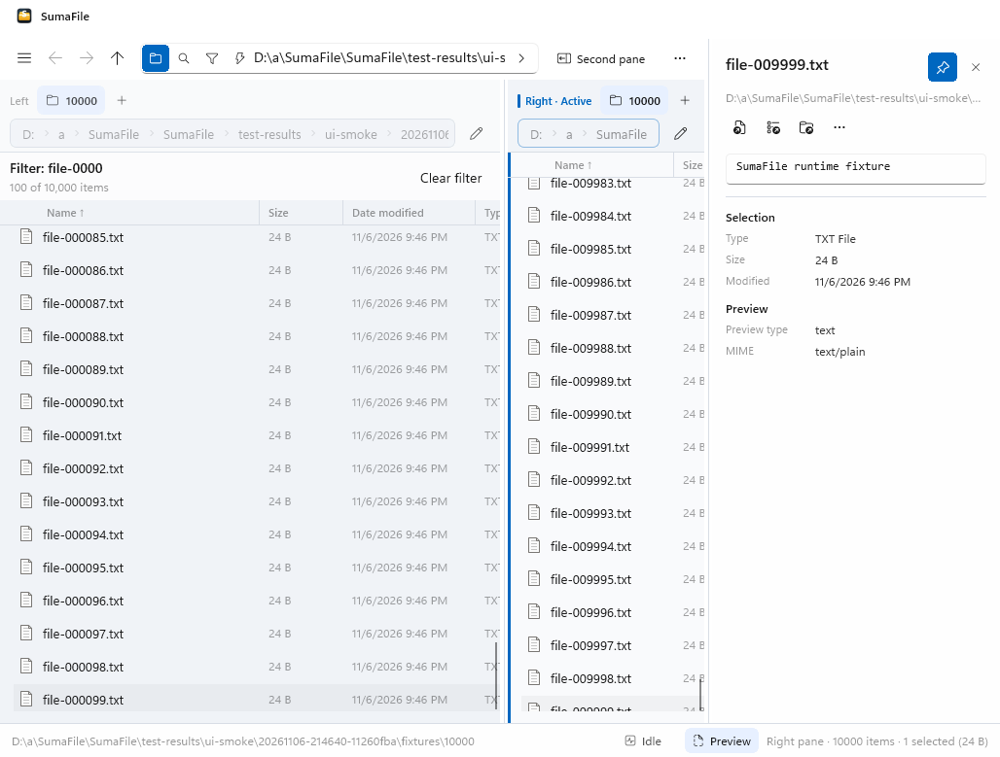
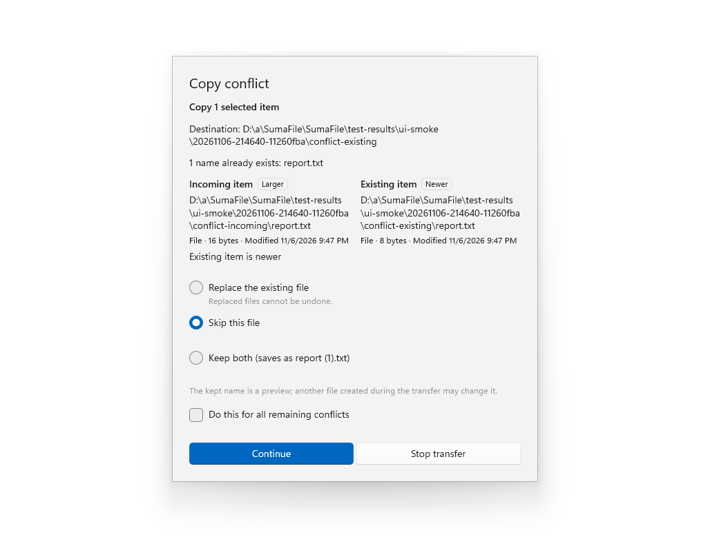
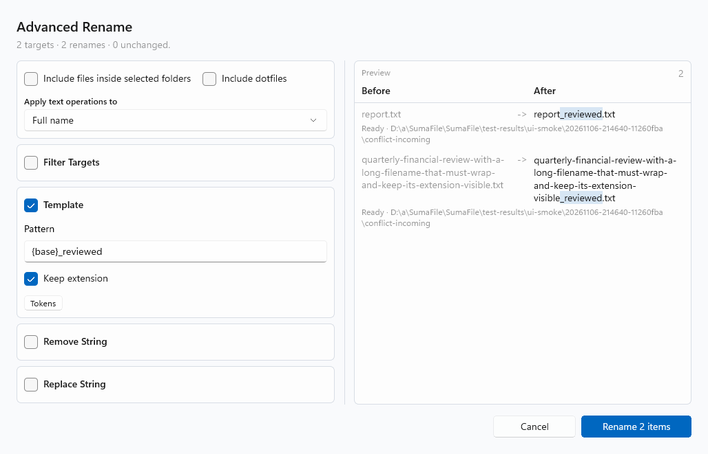

# SumaFile

[](https://github.com/conniecombs/SumaFile/actions/workflows/ci.yml)
[](https://github.com/conniecombs/SumaFile/actions/workflows/release.yml)
[](https://github.com/conniecombs/SumaFile/actions/workflows/installer-smoke.yml)


[](LICENSE)

SumaFile is a native Windows file manager for people who work across several
folders at once and need more than a basic file list. It pairs a WinUI 3 desktop
shell with a Rust filesystem service so browsing, transfers, search, previews,
archives, checksums, cleanup tools and, through bundled plugins, Git status and
remote FTP/SFTP profiles can stay responsive in one local-first app.

**Repository topics:** `windows`, `file-manager`, `winui-3`, `rust`,
`named-pipe-ipc`, `dual-pane`, `tabs`, `file-preview`, `advanced-rename`,
`archive-manager`, `checksum`, `git-status`, `windows-installer`,
`local-first`.

## Contents

- [Screenshots](#screenshots)
- [Status](#status)
- [Highlights](#highlights)
- [Install](#install)
- [Use SumaFile](#use-sumafile)
- [Feature Reference](#feature-reference)
- [Settings and State](#settings-and-state)
- [Transfer tuning](docs/TRANSFER_TUNING.md)
- [Development](#development)
- [Architecture](#architecture)
- [Testing and Verification](#testing-and-verification)
- [Release and Tags](#release-and-tags)
- [Documentation Map](#documentation-map)
- [Security](#security)
- [Known Limitations](#known-limitations)
- [Support](#support)
- [License](#license)

## Screenshots

**Dual-pane workspace.** The left pane filters 10,000 sample files down to 100
and shows the filter banner with its Clear filter action. The right pane is
marked active, keeps its own selection, and the pinned preview shows the
selected text file while both panes stay open.



**Copy conflict.** The dialog compares the incoming and existing files, marks
which one is larger and which is newer, and offers Replace, Skip and Keep both
as one choice. Skip is selected by default, **Continue** confirms, and the
Keep both option previews `report (1).txt`.



**Advanced Rename.** The `{base}_reviewed` template adds a suffix while preserving
the extension. The Before and After columns show both proposed names before you
apply them, and the Tokens button explains each placeholder.



These captures come from the running v1.0.4 WinUI app on a
[GitHub-hosted Windows runner](https://github.com/conniecombs/SumaFile/actions/runs/42298176359).
All visible files and paths belong to its generated test workspace.

## Status

| Area | Current state |
| --- | --- |
| Product version | `1.0.4` |
| Platform | Windows 10 2004+ / Windows 11, x64 |
| UI | Unpackaged WinUI 3 desktop app |
| Backend | Rust `simplefile-service` over named-pipe JSON-RPC |
| Release artifacts | NSIS setup, MSI, portable ZIP, updater manifest |
| Storage scope | Local folders, local drives, removable media, mapped network shares, archives, and an FTP/FTPS/SFTP profile browser from the bundled FTP/SFTP plugin |
| License | [MIT](LICENSE) |

The active application is the WinUI host under `src-winui/` plus the Rust crates
under `crates/`. Historical migration notes remain in `docs/winui-migration/`,
but the Svelte/Tauri surface is not the shipping UI for this branch.

## What changed in 1.0.4

Menus grey out what is unavailable instead of hiding it, Delete is a direct
menu item, and the omnibar returns to Path mode when a search or filter ends.
The conflict dialog uses one choice list with Continue as the default, the
Transfers window no longer steals focus, and transfer options show three
settings with the rest under Advanced. Git controls appear only inside a
repository, FTP/SFTP profiles get a trust prompt for new server keys, and
labels, the sidebar, profiles and connections each have one name everywhere.

See the [v1.0.4 release notes](docs/RELEASE_1.0.4.md) for the changes since
v1.0.3, upgrade instructions and known limitations.

## Highlights

| Need | SumaFile capability |
| --- | --- |
| Work in two locations | Dual-pane browsing with independent pane history, tabs, sort, view, and selection |
| Keep workspace context | Saved layouts for panes, tabs, columns, preview width, sidebar state, and pane split |
| Move files confidently | Copy/move progress, cancellation, conflict choices, Recycle Bin delete, and undo/redo |
| Inspect before opening | Persistent preview pane, Quick Look, metadata, checksums, properties, and compare |
| Organize messy folders | Tags, bookmarks, recents, smart folders, duplicate finder, cleanup, and Advanced Rename |
| Work with archives | Create, list, view, extract, pack, and unpack supported archives |
| Handle developer folders | Git status column and dockable Git workbench (bundled Git plugin), terminal launch, and Open With preferences |
| Reach remote servers | FTP, FTPS, and SFTP profile manager from the bundled FTP/SFTP plugin, with test, browse, upload, download, rename, and delete actions |
| Stay Windows-native | Drive labels, network-share status, shell icons, Windows installers, and Windows shortcuts |

## Install

Download the latest Windows release from
[GitHub Releases](https://github.com/conniecombs/SumaFile/releases).

| v1.0.4 artifact | Recommended use |
| --- | --- |
| `SumaFile_1.0.4_x64-winui-setup.exe` | Normal per-user installation |
| `SumaFile_1.0.4_x64-winui.msi` | MSI deployment or installer validation |
| `SumaFile_1.0.4_x64-winui-portable.zip` | Portable, extracted-folder usage |
| `latest-winui.json` | Signed updater metadata for published releases |

Requirements:

- Windows 10 version 2004 or newer, or Windows 11
- x64 Windows
- The SumaFile 7-Zip plugin (`com.sumafile.sevenzip`), installed with SumaFile, for `.7z` workflows
- The SumaFile FTP/SFTP plugin (`com.sumafile.remote`), installed with SumaFile, for FTP, FTPS and SFTP connections
- The SumaFile Git plugin (`com.sumafile.git`), installed with SumaFile, and Git for Windows with `git.exe` on `PATH`, for Git status and the Git workbench
- Built-in RAR listing and extraction; RAR creation is not supported

After installing, open Settings -> Updates to check published releases. Builds
with trusted updater metadata can download and launch the NSIS setup from inside
the app. Builds without complete trusted metadata fall back to the release page.

## Use SumaFile

1. Open SumaFile.
2. Choose a location from Quick Access, drives, bookmarks, recents, smart
   folders, the optional folder tree, or type a path in the omnibar.
3. Press `F6` to open or close the second pane.
4. Press `Ctrl+T` or `Ctrl+N` to open a tab in the active pane.
5. Leave Preview open for continuous inspection, or press `Space` for Quick
   Look on the selected item.
6. Use right-click menus, toolbar buttons, or `Ctrl+Shift+P` for command
   palette access. Right-click blank pane space for New (folder, text
   document, blank file, shortcut), Paste, Refresh, and the current
   folder's Properties. Right-click an item for Create
   shortcut, which pre-fills the shortcut target. Unavailable commands stay
   visible but greyed out.
7. Run FTP/SFTP manager from the command palette or the toolbar overflow when
   you need a saved FTP, FTPS, or SFTP connection. The bundled FTP/SFTP plugin
   provides it, and lists saved connections under Connections, below the
   built-in sidebar sections.
8. Save repeatable pane/tab/column setups from the Profiles button on the
   toolbar.

## Feature Reference

### Navigation and Layout

- Dual-pane browsing with independent active-pane state
- Pane-local tabs with history, close, switch, and direct tab shortcuts
- Breadcrumbs and a single omnibar for paths, commands, search, and filtering
- Quick Access, drives, bookmarks, recent locations, smart folders, and folder
  tree sections
- Details, list, tiles, and content views
- Per-pane view style, icon size, sort column, and sort direction
- Column presets: default, details, media, developer, and photo
- Explorer-style column resizing, size-to-fit, and horizontal scrolling
- Details stays selected in narrow panes, with compact leading columns and
  horizontal access to the remaining columns
- Persistent pane-local filter counts, Clear filter, and search result banners
  with Return to folder
- Marquee selection, multi-selection, type-ahead selection, and live directory
  refresh
- Recycle Bin as a browsable location with restore, permanent delete, and empty
  actions

### File Operations

- Create file and folder
- Rename and Advanced Rename
- Copy, cut, paste, drag, drop, copy to other pane, and move to other pane
- Transfer progress with bytes, totals, rate, ETA, cancellation, and operation
  history
- Per-file conflict handling for skip, replace, keep both, or fail. Retry uses
  each failed file’s original destination, including files nested inside merged folders.
- Overwrite comparisons show incoming/existing paths, sizes, modification
  dates, and a preview of the Keep both filename
- Recycle Bin delete and permanent delete
- Undo/redo for create, rename, copy, move, and Recycle Bin delete flows
- Clipboard history for recent copy/cut sets
- Operation journal written to `%LOCALAPPDATA%\SumaFile\operations.jsonl`

### Preview and Inspection

| Kind | Support |
| --- | --- |
| Images | PNG, JPG/JPEG, GIF, SVG, WebP, BMP, ICO, TIFF |
| PDF | Path-backed PDF preview and metadata |
| Video | MP4, WebM, AVI, MOV, MKV, FLV, WMV, OGG |
| Audio | MP3, WAV, FLAC, OGG, AAC, WMA, M4A, AIFF |
| Text and code | Plain text, source files, scripts, config, logs |
| Markdown | Raw text or rendered Markdown with GitHub-flavored tables and task lists |
| Data text | Rendered HTML, JSON/JSONL, CSV/TSV, XML/XAML, YAML, TOML, AsciiDoc, and reStructuredText views |
| Fonts | TTF, OTF, WOFF, WOFF2 |
| Other files | Shell icon and basic metadata fallback |

Inspection tools include:

- Preview pane with Open, Open With, Reveal in folder, Compare, and Checksum
  actions
- Pin preview open, or let unpinned preview collapse when empty or panes are
  cramped; automatic collapsing can be disabled in Settings -> Behavior
- Quick Look for focused inspection
- Properties dialog with path, type, size, timestamps, and attributes
- Image dimensions and EXIF where available
- Office/PDF/media metadata where available
- MD5, SHA-1, and SHA-256 checksums
- Text diff for two small UTF-8 files
- Binary comparison with hex/ASCII rows for images, executables, oversized text,
  invalid UTF-8, or other binary content
- A persisted Rendered toggle for Markdown and data files. Markdown task-list
  checkboxes are preview-only controls; change the source file to update task
  state.

### Search and Smart Folders

- Filter the active pane as you type in the omnibar’s Filter mode
- Recursive filename search
- Optional content search in the omnibar’s Search mode
- Filters for size, date, depth, and hidden-file inclusion
- Batched, cancellable search results for large trees
- Smart folders saved from reusable search criteria

### Archives

| Format | Extension(s) | Support |
| --- | --- | --- |
| ZIP | `.zip` | Built in |
| TAR | `.tar` | Built in |
| TAR.GZ | `.tar.gz`, `.tgz` | Built in |
| RAR | `.rar` | Built-in list/extract only |
| 7-Zip | `.7z` | SumaFile 7-Zip plugin (`com.sumafile.sevenzip`), installed with SumaFile |

Archive commands can list contents, view archives, extract here, extract to a
folder, extract to a chosen destination, create archives, pack selections into a
folder, and unpack folders in place. RAR archives can be browsed and extracted,
but SumaFile does not create or rewrite RAR archives.

Extraction validates final output paths before writing. TAR extraction skips
links and special entries that could escape the destination.

### Organization

- Labels for files and folders, shown under Labels in the sidebar
- Bookmarks and recent locations
- Smart folders
- Folder metrics
- Duplicate finder
- Advanced Rename with live preview and collision checks
- Rename preview shows full Before/After names, highlights changes, and labels
  each target Ready, Unchanged, or Conflict
- Settings-controlled hidden/system file visibility
- Keep-folders-on-top sorting mode

### Git and Developer Tools

- Git comes from the bundled Git plugin (`com.sumafile.git`), which needs Git
  for Windows with `git.exe` on `PATH`
- Developer column preset with a Status column of Git status labels
- Dockable Git workbench with branch/upstream summary, changed paths, resizable
  diff preview, stage, unstage, discard, fetch, pull, push, and commit actions;
  fetch, pull and push run as Transfers rows with Cancel
- Settings -> Plugins -> Git can completely disable Git integration, hiding Git
  UI and preventing Git status/command calls; the Git commands stay listed and
  explain that Git is turned off
- Open terminal here with ``Ctrl+` ``
- Elevated PowerShell launch
- Open With menu and chooser
- Pinned and recent Open With apps per extension
- Command palette with searchable app commands

### FTP/SFTP Manager

FTP, FTPS and SFTP come from the bundled plugin `com.sumafile.remote` ("FTP/SFTP
connections"), which installs and is trusted with SumaFile. It contributes the
FTP/SFTP manager window and command, the Connections sidebar section (below the
built-in sections) and its own page under Settings -> Plugins. Without the
plugin, SumaFile shows no FTP/SFTP UI.

- Saved FTP, FTPS, and SFTP profiles
- Password, anonymous, SSH agent, and private-key authentication modes
- Optional Windows Credential Manager storage for passwords and passphrases
- Profile test before save
- Remote folder browsing with create folder, upload, download, rename, delete,
  refresh, and disconnect actions
- Recursive folder uploads and downloads, including empty folders
- Streamed transfers with byte progress, per-item outcomes, and retry of
  incomplete selections; existing files are preserved until transfer
  completion using temporary files and replacement backups. Each transfer is
  also a row in the Transfers window, with Cancel
- File conflict choices: report, skip, replace, or keep both. Existing folders
  merge; the selected policy applies to files inside them. When retrying a
  partially completed folder, choose skip to keep files already transferred
- Retry remains available after reconnecting to the same profile; transfers
  restart incomplete files from the beginning
- Symbolic links are reported as unsupported during folder transfers
- Plain FTP requires an explicit insecure-connection acknowledgement and is
  marked Insecure in the manager and under Connections in the sidebar
- Remote transfer settings (bandwidth limit, up-to-date check, direct writes,
  pre-allocation, flushing and retries) are the plugin's settings, under
  Settings -> Plugins -> FTP/SFTP connections and in the manager's Transfer
  options dialog

The plugin's backend keeps profiles in
`<install folder>\plugins-data\com.sumafile.remote\remote-profiles.db`: every
plugin file, its data included, stays in SumaFile's installation folder.
On first use after an upgrade from 1.0.4 it imports, read-only, the profiles the
1.0.4 service saved in its `metadata.db`; saved passwords and passphrases stay
in Windows Credential Manager under their `SumaFile.Remote.` targets and keep
working without being entered again. Remote sessions end with the plugin's
backend, not with the file service.

### Transfer speed and automatic retries

Filesystem file/folder copies and moves (including mounted cloud drives, mapped
shares, removable drives, and cross-volume moves) share the same transfer engine.
FTP, FTPS, and SFTP uploads/downloads in the FTP/SFTP plugin use the same
staging and retry code with the plugin's own settings (Settings -> Plugins).
Remote sessions copy one file at a time. Same-volume moves can use a direct
rename.

- **Custom** keeps the selected concurrency, subject to the chosen buffer budget,
  shared process resource bounds and provider capabilities. Slow I/O and errors
  never replace it with a smaller learned value.
- **Zero bandwidth means unlimited in every mode.** There is no additional safety
  rate. Successful cloud reads, NAS writes, metadata gaps and durability flushes
  cannot impose a hidden limit. Native streams charge actual payload bytes,
  including short reads and small files, rather than reserving full buffers at EOF.
- Automatic modes compare sustained aggregate throughput while work is queued.
  They can test more/fewer workers and back off after actual I/O failures. A quiet
  window alone is not a failure. Settings learned by the former latency-based
  controller are not reused.
- A failing file or finalization step uses configurable retry limits. New-policy
  defaults are ten low-level attempts and three file passes, with cancellable
  exponential waits starting at one second. **Retrying failed I/O** identifies
  the actual failing phase/path. The affected file waits; healthy workers and new
  files continue within their configured limits. Permission, conflict, missing-file,
  invalid-data, authentication, and certificate/host-key errors fail promptly.
- Empty and partially written operation-owned filesystem temporary files resume
  correctly. FTP/SFTP plugin retries reconnect and restart the incomplete staged
  file from byte zero. Completed files are retained; failed moves retain sources.
  The first error is preserved alongside any later failure. Buffered writes and
  durability checks still complete before a filesystem destination is promoted.
- **Write directly to the destination** (Advanced transfer options) skips the
  hidden temporary files. New files and folders are created under their final
  names, and replaced files are overwritten in place; the FTP/SFTP plugin's
  own "Write downloads directly to the destination" setting does the same for
  remote downloads. A cancelled or failed transfer then leaves partial files and
  folders behind instead of the untouched original.
- SumaFile does not read or control pCloud Drive's cache occupancy. Its buffer
  budget is RAM, and temporary files are on the destination. A synchronous OS
  filesystem call may remain blocked until its driver returns. Archive creation/
  extraction retains its separate format-specific engine.

## Settings and State

Settings is organized into:

| Section | Controls |
| --- | --- |
| Appearance | Theme (Windows default, Dark, Light), default display style, default icon size, default file list columns, hidden files |
| Navigation | Start location (Home folder, Restore last session, Custom folder), new-tab behavior, sidebar sections, recent history |
| Behavior | Recycle Bin prompt, folders on top, folder sizes, rendered previews, video playback, preview collapse, and transfer options |
| Storage & cache | Thumbnail cache enablement, cache size, and cache location |
| Shortcuts | Searchable shortcut list with edit, reset, import, and export |
| Toolbar | Button labels, command order, separators, removed commands, and reset |
| Tools | Archive support summary |
| Plugins | Installed plugins, their settings and pages, such as the FTP/SFTP plugin's page (opens the FTP/SFTP manager) below its declared settings and the Git plugin's on/off setting |
| Updates | Version, update check, install action |
| About | Product, version, repository, and build metadata |

Startup can open Home, the last used workspace, or a custom path. Last-used
state persists panes, active pane, tabs, view mode, icon size, sort, and filter
context. Named profiles are separate snapshots available from the Profiles
button on the toolbar; applying a profile does not change the folders-on-top
setting or the Git plugin's settings.

Persistent compatibility data stays at:

```text
%APPDATA%\com.simplefile.desktop
```

No manual import is needed for normal SimpleFile-to-SumaFile use. SumaFile
keeps this path for compatibility with earlier SimpleFile builds and also falls
back to legacy `SimpleFile` / `SumaFile` app-data folders when an existing
metadata database is found there.

Runtime diagnostics are written under:

```text
%LOCALAPPDATA%\SumaFile\startup.log
%LOCALAPPDATA%\SumaFile\operations.jsonl
```

## Keyboard Shortcuts

Press `F1` or `Ctrl+/` in SumaFile for the live shortcut list.

| Shortcut | Action |
| --- | --- |
| `Ctrl+L` / `Alt+D` | Focus path bar |
| `Enter` | Open selected item |
| `Ctrl+Enter` | Open folder in new tab |
| `Alt+Enter` | Properties |
| `Alt+Home` | Go home |
| `Alt+Up` | Parent folder |
| `Alt+Left` / `Alt+Right` | Back / forward |
| `Backspace` | Back (when a file list has focus) |
| `F5` | Refresh |
| `F6` | Open or close second pane |
| `Tab` | Switch active pane when a file list has focus and dual pane is open |
| `Alt+1` / `Alt+2` | Focus left / right pane |
| `Ctrl+Shift+Left` / `Ctrl+Shift+Right` | Focus left / right pane |
| `Ctrl+T` or `Ctrl+N` / `Ctrl+W` | New tab / close tab |
| `Ctrl+Tab` / `Ctrl+Shift+Tab` | Next / previous tab |
| `Ctrl+1`-`Ctrl+9` | Jump to tab; `9` means last tab |
| `F2` | Rename |
| `Delete` / `Shift+Delete` | Recycle Bin delete / permanent delete |
| `Ctrl+C` / `Ctrl+X` / `Ctrl+V` | Copy / cut / paste |
| `Ctrl+Shift+C` | Copy path |
| `Ctrl+Shift+V` | Clipboard history |
| `Ctrl+A` | Select all |
| `Ctrl+Shift+N` | New folder (New text document is in the New menu) |
| `Ctrl+Z` | Undo |
| `Ctrl+Y` / `Ctrl+Shift+Z` | Redo |
| `Ctrl+Alt+C` / `Ctrl+Alt+M` | Copy / move to other pane |
| `Space` | Quick Look (when a file list has focus) |
| `Alt+P` | Show or hide the preview pane |
| `Ctrl+H` | Show or hide hidden/system files |
| `Ctrl+B` | Bookmark current folder |
| `Ctrl+Mouse wheel` | Change icon size |
| `Ctrl+F` / `F3` | Focus the omnibar in Search mode |
| `Ctrl+Shift+P` | Command palette |
| ``Ctrl+` `` | Open terminal here |
| `Ctrl+,` | Settings |
| `Escape` | Close transient UI, clear filter, or clear selection |

## Development

### Prerequisites

| Tool | Version | Purpose |
| --- | --- | --- |
| Windows | Windows 10 2004+ or Windows 11 x64 | Target platform |
| Node.js | Exact version in `.node-version` | Root scripts and checks; run `npm ci --ignore-scripts` |
| Rust | Exact MSVC toolchain in `rust-toolchain.toml` | `simplefile-core`, `simplefile-ipc`, `simplefile-service` |
| .NET SDK | Exact version in `global.json` | WinUI solution and tests |
| Windows SDK | 10.0.19041+ | WinUI target platform |
| NSIS | Optional | NSIS setup executable |
| WiX v3 | Optional | MSI package |
| Bundled 7-Zip files | In repo (`third_party/7zip/win-x64`) | Staged into the 7-Zip plugin folder for `.7z` archive operations and packaged payload checks |

### Run Locally

```powershell
git clone https://github.com/conniecombs/SumaFile.git
cd SumaFile
npm run dev
```

`npm run dev` builds the Rust service and starts the WinUI app. To run the UI
against a specific service binary:

```powershell
$env:SIMPLEFILE_SERVICE_PATH = "R:\path\to\simplefile-service.exe"
npm run dev:winui
```

Useful local-only overrides:

| Variable | Purpose |
| --- | --- |
| `SIMPLEFILE_SERVICE_PATH` | Use a specific `simplefile-service.exe` |
| `SIMPLEFILE_APP_DATA_DIR` | Redirect app data for fixtures or tests |
| `SIMPLEFILE_METADATA_DB` | Point settings/tags to a specific metadata database |
| Settings > Plugins > 7-Zip archives > 7-Zip executable override | Use a specific 7-Zip executable (a file, or a folder holding `7zz.exe`, `7z.exe` or `7za.exe`) instead of the plugin's bundled `7za.exe` |
| `SIMPLEFILE_UPDATE_MANIFEST_PATH` | Test updater metadata from a local file |
| `SIMPLEFILE_UPDATE_MANIFEST_JSON` | Test updater metadata from inline JSON |

`SIMPLEFILE_7Z` is no longer read. While it is set and the override is empty,
the 7-Zip plugin's backend logs a one-time warning that names the setting.

### Common Commands

Run these from the repository root.

| Command | Purpose |
| --- | --- |
| `npm run dev` | Build service and run the WinUI app |
| `npm run build:winui` | Build the WinUI solution in Debug |
| `npm run check:winui` | Run the WinUI xUnit suite |
| `npm run check:winui-release-hash` | Verify production release artifact hashing |
| `npm run check:rust` | Rust format check, tests, and Clippy with warnings denied |
| `npm run check` | Repo guard scripts for IPC, identity, updater, workflows, packaging, and parity |
| `npm run check:release` | `check` + Rust checks + dependency audit |
| `npm run test:maintenance` | Failure classification, required gates, update/merge policy, and mocked PR recovery |
| `npm run maintenance:plan` | Offline preview of GitHub protection/settings; applies nothing |
| `npm run maintenance:toolchains` | Read-only preview from official toolchain release feeds |
| `npm run release:prepare -- VERSION` | Preview a coordinated release-version change; add `--write` to apply locally |
| `npm run build` | Build release payload/installers through the WinUI release script |
| `npm run release:build` | Local release pipeline alias |
| `npm run generate:ipc-bindings` | Regenerate schema-derived Rust/C# IPC bindings |
| `npm run smoke:winui` | Launch smoke for built payload |
| `npm run smoke:winui-ui` | Real WinUI rendering, large-folder measurements, layout, navigation, and cancellation checks |
| `npm run smoke:winui-file-ops` | File operation smoke |
| `npm run smoke:winui-msi` | MSI extraction/launch smoke |
| `npm run smoke:winui-installer` | NSIS install/launch/uninstall smoke |
| `npm run smoke:winui-upgrade` | Previous release to local installer upgrade smoke |
| `npm run smoke:winui-upgrade-from-ref` | Upgrade smoke from a specific Git ref |

## Architecture

```text
SumaFile.exe
  WinUI 3 desktop shell
  panes, tabs, sidebar, dialogs, preview, transfers, settings
        |
        | length-prefixed named-pipe JSON-RPC
        v
simplefile-service.exe
  dispatcher, watcher, search, progress, cancellation, plugin archive engines
        |
        v
simplefile-core
  file ops, archive, preview data, metadata, checksum, compare,
  drives, tags, smart folders, updater, shell helpers
```

Important contracts:

- The app owns one service process per UI process.
- The service is tied to the UI process with a Windows job object, while files
  opened through the shell can outlive SumaFile.
- IPC contracts live in `ipc/schema/v1`; generated Rust and C# bindings must
  remain synchronized.
- Windows packaging must ship `SumaFile.exe`, `simplefile-service.exe`,
  `resources.pri`, XBF files, and Windows App SDK dependencies together.
- Runtime identity is SumaFile, while selected internal namespaces and
  compatibility paths intentionally keep the SimpleFile name.

## Project Layout

```text
SumaFile/
|-- src-winui/
|   |-- SimpleFile.App/       WinUI window, dialogs, preview, toolbar, panes
|   |-- SimpleFile.Core/      Workspace, settings, menus, transfers, preview helpers, layout state
|   |-- SimpleFile.Ipc/       Named-pipe JSON-RPC client and generated bindings
|   `-- SimpleFile.Tests/     xUnit tests for WinUI/core/IPC behavior
|-- crates/
|   |-- simplefile-core/      Filesystem, archive, preview, metadata logic
|   |-- simplefile-ipc/       Protocol constants, framing, schema tests
|   `-- simplefile-service/   Rust named-pipe service process
|-- ipc/schema/v1/            JSON-RPC command, type, event, and golden files
|-- packaging/winui/          NSIS, WiX, and Windows assets
|-- scripts/                  Checks, release scripts, smoke tests, codegen
|-- docs/                     Roadmap, support, updater, release, migration docs
|-- build_notes/              Maintainer notes from hardening and migration work
|-- .github/workflows/        CI, release, release-build, installer smoke
|-- package.json              Root command runner
|-- Cargo.toml                Rust workspace
`-- LICENSE                   MIT License
```

## Testing and Verification

Recommended local development gate:

```powershell
npm run build:winui
npm run check:winui
npm run check:winui-release-hash
npm run smoke:winui-ui
npm run check
npm run check:rust
git diff --check
```

Release-quality gate:

```powershell
npm run check:release
npm run release:build
npm run smoke:winui
npm run smoke:winui-file-ops
npm run smoke:winui-msi
npm run smoke:winui-installer
npm run smoke:winui-upgrade
```

| Gate | Coverage |
| --- | --- |
| `check:ipc-generated` | Generated Rust/C# IPC bindings match schema |
| `check:ipc-schema` | Schema, service dispatcher, and C# client stay aligned |
| `check:identity` | Current-facing files use SumaFile repository identity |
| `check:updater` | Updater URL, signature, and manifest wiring |
| `check:workflows` | GitHub Actions workflow surface |
| `check:provider-surface` | External account-backed storage surfaces remain out of scope |
| `check:windows-assets` | Windows app and packaging assets |
| `check:winui-packaging` | NSIS/MSI/release-script contracts |
| `check:winui-parity-gate` | WinUI parity rows remain PASS/WAIVED |
| `check:winui` | xUnit app/core/IPC tests |
| `check:winui-release-hash` | Production SHA-256 known vectors and artifact access/error behavior |
| `smoke:winui-ui` | Real Debug host/service rendering, virtualization, layout, selection, navigation, and cancellation; see [runtime verification](docs/WINUI_RUNTIME_VERIFICATION.md) |
| `check:rust` | Rust fmt, tests, and Clippy |
| `check:security` | Rust dependency audit |

Installer and upgrade smokes are slower by design. Use them before shipping
release assets or changing packaging/update behavior.

## Release and Tags

Release outputs are written under `dist/winui/` by
`scripts/build-winui-release.ps1`.

| Output | Contents |
| --- | --- |
| `payload/` | Runnable unpackaged app folder |
| `SumaFile_<version>_x64-winui-portable.zip` | Portable package |
| `SumaFile_<version>_x64-winui-setup.exe` | NSIS per-user installer |
| `SumaFile_<version>_x64-winui.msi` | MSI package |
| `latest-winui.json` | Signed updater manifest |

Version fields that must stay synchronized:

- `src-winui/Directory.Build.props`: `<Version>` and
  `<InformationalVersion>`
- `crates/simplefile-core/src/lib.rs`: `APP_DISPLAY_VERSION`
- `crates/simplefile-core/Cargo.toml`
- `crates/simplefile-ipc/Cargo.toml`
- `crates/simplefile-service/Cargo.toml`
- `Cargo.lock` and NuGet project-reference lock entries
- `src-winui/SimpleFile.App/app.manifest` and the NSIS numeric fallback
- README badges and install artifact names
- `docs/CHANGELOG.md`

Git release tags use `vMAJOR.MINOR.PATCH`, for example `v1.0.3`.

Before creating a release tag:

1. Confirm the version fields above match.
2. Run `npm run check:release`.
3. Run the WinUI smoke commands required by `docs/RELEASE_1.0.4.md`.
4. Confirm the Installer Smoke workflow succeeds on the release commit.
5. Merge the version bump, then tag the merged commit or start a new Release run from the updated `main`.

More detail lives in [.github/RELEASE.md](.github/RELEASE.md) and
[docs/UPDATER_RELEASE.md](docs/UPDATER_RELEASE.md).

## Documentation Map

| Document | Use it for |
| --- | --- |
| [docs/CHANGELOG.md](docs/CHANGELOG.md) | Current and historical changes |
| [docs/ROADMAP.md](docs/ROADMAP.md) | Near-term priorities and branch scope |
| [docs/FEATURE_OPPORTUNITIES.md](docs/FEATURE_OPPORTUNITIES.md) | Candidate product gaps and recently closed gaps |
| [docs/CONTRIBUTING.md](docs/CONTRIBUTING.md) | Contributor workflow and expectations |
| [docs/CI_MAINTENANCE.md](docs/CI_MAINTENANCE.md) | Pinned toolchains, bounded repair, update PRs, merge gates, and separate activation steps |
| [docs/SUPPORT.md](docs/SUPPORT.md) | Useful details for reports |
| [docs/SECURITY.md](docs/SECURITY.md) | Vulnerability reporting and sensitive-file rules |
| [docs/UPDATER_RELEASE.md](docs/UPDATER_RELEASE.md) | Signed updater releases |
| [docs/RELEASE_1.0.4.md](docs/RELEASE_1.0.4.md) | Changes since v1.0.3, upgrade instructions and release checklist |
| [docs/RELEASE_1.0.3.md](docs/RELEASE_1.0.3.md) | Changes since v1.0.2, upgrade instructions and release checklist |
| [docs/RELEASE_1.0.2.md](docs/RELEASE_1.0.2.md) | Complete 1.0.1 → 1.0.2 release notes, upgrade guidance and checklist |
| [docs/RELEASE_1.0.1.md](docs/RELEASE_1.0.1.md) | Historical 1.0.1 release checklist |
| [docs/RELEASE_1.0.0.md](docs/RELEASE_1.0.0.md) | Historical 1.0.0 release checklist and dogfood plan |
| [.github/RELEASE.md](.github/RELEASE.md) | Release process |
| [src-winui/README.md](src-winui/README.md) | WinUI host build/run notes |
| [docs/winui-migration/](docs/winui-migration/) | Historical migration architecture and parity records |

## Security

- Do not commit updater private keys, signing keys, `.env` files, local secrets,
  personal settings exports, or logs containing private paths.
- Gitignored sensitive locations include `.secrets/`, `*.key`, `.env`, and
  `.env.*`.
- Archive extraction validates destination paths before writing.
- TAR extraction skips links and special entries.
- Open With refuses executable/script payload files as launch targets.
- Report vulnerabilities through [docs/SECURITY.md](docs/SECURITY.md).

## Known Limitations

- SumaFile 1.0.4 is Windows-only.
- Installing SumaFile for the first time is manual; in-app update installation requires a
  newer published release with signed `latest-winui.json` metadata.
- RAR archives can be listed and extracted, but RAR creation and in-place RAR
  rewrites are not supported.
- Account-backed storage integrations are intentionally out of scope for this
  branch. FTP/FTPS/SFTP profiles are available in the FTP/SFTP plugin's
  separate manager window, not mounted into the main panes.
- Rendered Markdown task-list checkboxes are read-only preview controls; editing
  task state requires editing the Markdown source.
- Some Windows-reserved shortcuts may not be assignable; shortcut remapping,
  import, and export live in Settings -> Shortcuts.
- Inline rename is available in the Details view; List, Tiles and Content views
  still open the rename dialog.

## Support

When reporting an issue, include:

- Windows version
- SumaFile version from Settings -> About or the About dialog
- Whether you used the setup executable, MSI, portable ZIP, or a dev run
- The exact path/workflow where the issue happened, with private path segments
  redacted if needed
- Relevant snippets from `%LOCALAPPDATA%\SumaFile\startup.log`
- Relevant snippets from `%LOCALAPPDATA%\SumaFile\operations.jsonl`
- Whether `npm run smoke:winui`, `npm run smoke:winui-file-ops`,
  `npm run smoke:winui-msi`, and `npm run smoke:winui-installer` pass locally
  when the issue involves install, startup, updates, or filesystem operations

See [docs/SUPPORT.md](docs/SUPPORT.md) for the full support checklist.

## License

SumaFile is open-source software licensed under the [MIT License](LICENSE).

Copyright (c) 2024-2026 conniecombs.

Third-party libraries remain governed by their own license terms. Bundled 7-Zip
console files are distributed with their upstream license in
[`third_party/7zip/win-x64/License.txt`](third_party/7zip/win-x64/License.txt).
An installed SumaFile ships that `License.txt` beside the 7-Zip files in
`plugins\com.sumafile.sevenzip`.
